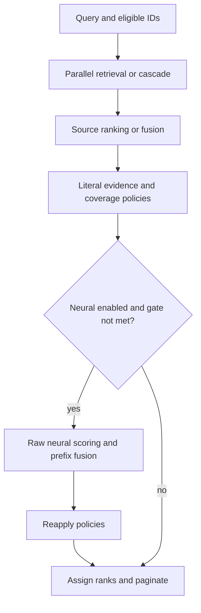
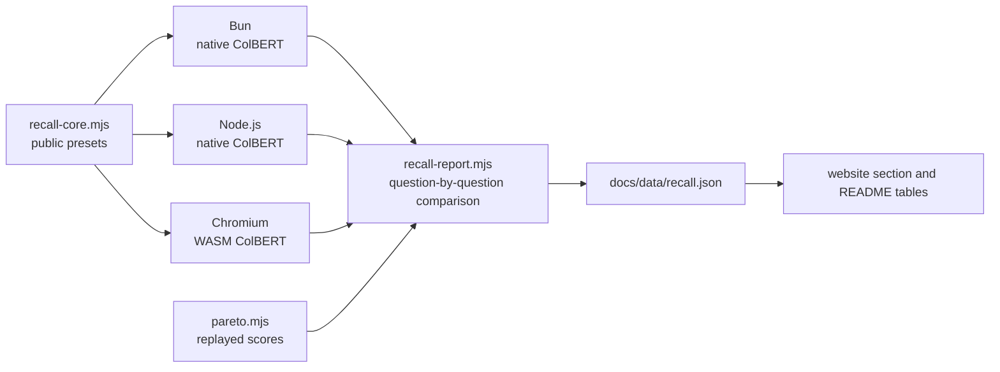

# Architecture

VERIFIED: defuss-search composes ordered lexical and vector retrieval over stable string IDs. It delegates tokenization, BM25, vector math and model inference to defuss-lexicalsearch and defuss-vectorsearch. Reimplementing those algorithms here would create inconsistent behavior and duplicate their maintenance.

## Query lifecycle

VERIFIED: a query copies its vector, options and eligibility set before asynchronous work. Independent retrieval can run concurrently; cascades score only their first-stage IDs. Policies act on the full finite ordering before pagination.

VERIFIED: `src/engine.ts` coordinates these stages. `src/core/` holds pure validation and ordering functions. `src/pipeline/` invokes callbacks and records stage boundaries. `src/adapters/` maps published package APIs to those contracts. `src/index.ts`, `src/lexical.ts`, `src/vector.ts`, `src/colbert.ts` and `src/indexing.ts` are the public entry modules. `src/presets.ts` supplies the measured configurations as explicit options; without a preset, `src/core/options.ts` sets the defaults.

## Ranking invariants

VERIFIED: one source supplies at most one vote per ID. RRF uses one-based input positions; it does not reorder exact-first lexical tiers by raw score. Linear fusion requires monotonic raw scores and normalizes within the retrieved lists. Both methods use stable ID tie-breaking.

VERIFIED: a cascade's second stage cannot add candidates. Unmatched candidates remain in original order unless dropped explicitly. Literal lookup may add candidates only in fusion mode. Exact promotion and source coverage are explicit constraints; infeasible combinations throw. Neural reranking must return a complete permutation of its prefix, and untouched tail candidates follow it.

VERIFIED: final `rank` is authoritative. Different stages can attach incomparable score scales. First-stage and neural contributions remain separate so dense retrieval is not accidentally counted twice through upstream `rerankHits()`.

## Avoiding unnecessary neural work

VERIFIED: `src/core/rerank-gate.ts` examines raw vector scores and source/current-winner agreement before any reranker call. It never thresholds a fused score. Skips preserve the current ranking, retain exact and eligibility constraints, and report `rerankDecision` without inventing neural evidence. Incomplete, nonmonotonic, overflowing or conflicting evidence leaves inference enabled.

VERIFIED: the efficient preset pays for independent lexical/vector retrieval but no neural stage. The reranked preset, which `searchPreset()` returns by default since the maintainer chose it on 2026-11-09, refines a bounded prefix with a weak neural vote, whose algebraic bound preserves the prior winner. A default that fails without a reranker beats one that silently skips the neural stage: a search built from `searchPreset()` either reranks or says it cannot. This avoids replacing a strong lexical result with an equally weighted weak neural signal. The website demo runs the gate before it loads ColBERT: a question whose gate skips the reranker ranks without the model.

VERIFIED: the full-data and grouped holdout measurements, selection rule and inference-work definition are in `docs/pareto.md`. They establish a finite empirical frontier, not universal relevance or wall-clock optimality. Raw model scores are measured once and reused for fusion/gate comparisons; actual load suppression is checked separately on native CPU and WASM.

## Language and model contracts

VERIFIED: lexical analyzers are caller-selected, normally per field. The package forwards language-specific behavior rather than guessing a query language. The owned-index factory accepts the full lexical schema. Tests cover all 20 released language entry points.

VERIFIED: a query's `language`, such as a language identifier's guess, passes through the lexical adapter to defuss-lexicalsearch's `language` option, which weighs the fields of that language three times more and leaves every other field searchable; it overrides a fixed `search.language`. The same `language` picks the presets' fusion through `fusion.byLanguage`: RRF k=20 in Winzling-embed's eight target languages, whose vectors are much stronger, and k=0 in every other language or without one, both with lexical and vector weights 2:1. The group tunes only k: its own best weights, 1:1, cost a guessed `language` 1.5 points R@1 when BM25 searches all 20 fields. VERIFIED: on the 500 held-out benchmark questions this raised R@1 from 92.4% to 93.6% at the same R@5 (`bench/pareto.mjs`, 2026-11-10); `bench/language-groups.mjs` scored groupings tuned on one half of the questions on the other half: four groups by language family led these two by 0.15 points R@1 on average, 1.5 of 1,000 questions, and searched bins or one group per language scored lower. Detection stays with the caller, so an application that knows its users' language, or uses BM25 alone, loads no identifier: defuss-lid's `major_20` pack and runtime take 208 kB gzipped. Unstemmed companions copy their analyzer's language, so the boost reaches them with their field. `bun run bench:language-guess` measured the presets over all 20 Belebele fields: with defuss-lid 0.5.0 guesses, 987 of 1,000 right, and the defuss-vectorsearch 0.4.0 models, the efficient preset reached 89.7% R@1 and 96.5% R@5, against 81.5% and 93.1% without a language and 92.5% and 97.3% with the known language (2026-11-10). With one fusion setting for every language the guess reached 89.9% R@1 and 96.5% R@5. A boost beats searching only the guessed field because identifiers misread short queries; defuss-lexicalsearch's ARCH.md has that comparison.

VERIFIED: vector rows are copied alongside their stable IDs. Cosine mode normalizes owned copies; dot-product mode retains magnitude. TurboQuant retains float vectors for exact rescoring and scans the corpus. It is not an ANN graph and does not claim quantized-only memory savings. Query and document vectors must use compatible model/preprocessing settings; matching dimensions alone cannot establish this.

## Measuring recall

VERIFIED: `bench/recall-core.mjs` measures R@1, R@5, R@10 and R@25 per query language by calling `HybridSearch` with `searchPreset('efficient')` and `searchPreset('reranked')`. It imports the published packages, the language fixture and the website's static analyzer imports, none of which uses a Node.js API, so Bun, Node.js and a Chromium bundle run the same module. A replay of cached neural scores, as in the frontier analysis, can drift from the engine; an end-to-end run cannot. The frontier report still serves parameter selection, because replaying 32 neural configurations costs one inference pass instead of 32.

VERIFIED: `scripts/recall-report.mjs` takes the Bun run as reference, counts per preset the questions whose rank or neural decision differs in Node.js or Chromium, and publishes those counts. It fails when the frontier replay disagrees with the end-to-end figures for any language and k. `scripts/check-project.mjs`, part of `make verify`, fails when the generated website section or README tables differ from what `docs/data/recall.json` renders. The browser run serves its bundle, data and model files through Playwright routing on an `https` origin: no port opens, and `crypto.subtle` can verify the model's SHA-256 pins.

## Short-text routing

VERIFIED: `vectorOnlyBelow` lets a fusion query skip BM25 and the reranker when the lexical adapter's documents average fewer analyzed terms than the threshold. The adapter computes that average from the index statistics of the fields it searches, so a keyword field next to a text field adds its terms to the same documents and disjoint per-language fields add up to the whole index. `bun run bench:bm25-switch` shows why the option stays opt-in (2026-11-01, with the defuss-vectorsearch 0.2.1 models). On the demo's notes, where the relevant results are translations and paraphrases, the vector source alone reached 98.9% R@1 against 61.5% for the reranked preset. On Belebele passages cut to the same length, where the relevant passage shares the question's language and words, BM25 led with 47.4% against 19.8%. A rule on length alone would trade one corpus for the other.

## Weak-lexical promotion

VERIFIED: with the presets' fusion weights, BM25's first hit receives 2/(0+1) = 2 points and the vector source's first hit at most 1/(0+1) = 1, so BM25 decides the top even when its first hit shares a single common word with the query. In the demo, "Mehr Kontakt mit Tieren" ranked a doctor's note and a tomato-sauce note first, because both contain "mehr"; with the rule, a note about a dog's vaccination leads. `src/pipeline/weak-lexical.ts` checks the evidence behind that first hit after reranking. The lexical adapter's `matchShare()` searches each whitespace word of the query alone. Each word is weighted by BM25's inverse document frequency from the search total, and the share is the matched part of the summed weights. Stopwords report no expanded term and drop out; a word absent from the index carries the largest weight. When the share is below 0.2 and the vector source's first hit leads BM25's first hit by more than 0.15 cosine, that vector hit moves to the top. When BM25's first hit is not among the vector candidates, its cosine comes from a rescore of that one document, also for a query given as text alone: the vector adapter keeps the last query's embedding and the ColBERT retriever the last scan, so the rescore runs no model. Without that rescore, text-only queries fell back to a bound and moved the vector hit for 3 Belebele questions instead of 10.

Moving one hit beats the two alternatives that `bench/confidence-fusion.mjs` measured. Dropping BM25 for the query reached the same R@1 but lost up to 9.7 points of R@5 on short passages (2026-11-09 run), because BM25's other good hits left the first five. Scaling BM25's fusion weight by the share cost Belebele 6.5 points of R@1. The share uses the index's own statistics, so the library ships no word-frequency tables, and the rule follows each field's analyzer, stopwords included. Taking frequencies from a background corpus per language did about as well, but it needs data for every language and field. Unspaced Japanese, Chinese or Thai queries form a single word, so their share is 0 or 1.

## Unstemmed companions

VERIFIED: `bun run bench:errors` (2026-11-01, defuss-vectorsearch 0.2.1 models) traced all 29 rank-1 misses on exact words in the defuss-shadcn docs to stemming collisions: the stemmer mapped another word onto the query's stem, and the section that repeated that word won. `withSurfaceFields()` in `src/adapters/lexical.ts` therefore adds, for every field whose analyzer stems, a derived field that analyzes the same text with the analyzer minus its stemmer and phonetic key. A word as written then scores in both fields, a different word with the same stem in one. A derived field (`source`) beats a second document field because callers pass their documents unchanged and each text is stored once; the postings still double. `bench/surface.mjs` measured the efficient preset: exact docs words rose from 71% to 98% R@1, natural-language docs queries from 37% to 40%, the notes stayed equal and Belebele moved from 91.3% to 91.2%, one question of 1,000. Weight 0.5 reached 94% on the exact words, so the default weight is 1.

VERIFIED: `createHybridIndex()` adds the companions by default, because it owns the index, and the measured cost of the default is five Belebele questions that left the top 5 (two more reached rank 1) against 27 of 100 exact-word queries gained at rank 1 (2026-11-09, defuss-vectorsearch 0.3.1 models). Fields without a stemmer get none: their companion would hold the same terms and act as a higher weight on the field, while doubling its memory. The strategies wrap a caller's `LexicalSearch`, whose schema is fixed at construction, so for them the caller builds the options with `withSurfaceFields()`. `createLexicalRetriever()` recognizes a companion by its name `<field>~surface` next to an existing `<field>`, adds it to a field restriction and leaves it out of `averageLength()` and `matchShare()`; counted, it would double the average document length that `vectorOnlyBelow` compares. The website demo and the recall benchmark index Belebele without companions, since there they cost 49% more indexed tokens and moved R@5 by −0.5 points.

## Ready-made strategies

VERIFIED: `src/strategies.ts` builds the three searches on `HybridSearch` rather than as separate engines, so the lexical-only search returns the same hits, explanations and policies as the semantic ones, and an application can add a model later without changing how it reads results. The lexical-only search passes a vector source that returns no candidates. The two semantic factories import their adapters with dynamic `import()`, so the built `dist/strategies.js` statically imports only the lexical adapter, the engine, the root entry for the presets and a validation chunk. An application that uses only BM25 loads no defuss-vectorsearch code. Both semantic factories also take a `vector` source built earlier: searches that differ only in their lexical options, such as the website demo's 20 per-language searches, then share one token index or vector set instead of each holding a copy.

VERIFIED: the tiny strategy uses MoEdernColBERT as a first-stage retriever, because it is the only model under 4 MB in the pinned set. ColBERT keeps one vector per token, so `src/adapters/colbert-retriever.ts` stores 128-dimensional unit vectors as TurboQuant codes of 64 bytes, an eighth of their float32 size. With the previous ColBERT (2026-11-01), the codes missed exact token cosines by 0.009 on average over Belebele's passage tokens. With the edited ColBERT of defuss-vectorsearch 0.3.1, against the exact index, the codes lost 2 of 91 notes found by their translations at rank 1 and 3 from the top 5, and changed nothing on the paraphrase queries and the API fixture (`bench/strategies.mjs`, 2026-11-09). A query scores every stored token, so its time grows with the corpus: 119 ms over Belebele's 180,626 tokens and 1.3 s over the 2,070,073 tokens of the defuss-shadcn sections in that run; four earlier runs ranged from 117 to 240 ms and 1.3 to 2.5 s. Winzling's single vector per document is 1,536 bytes, against 5.8 to 16.5 KB of codes per document for ColBERT on those corpora. The retriever keeps the last query's scores, so the rescore of the same search reuses one scan.

VERIFIED: on 91 notes found by their translations, the tiny search reached 47.3% R@1, against 22.0% for BM25 alone and 97.8% for the Winzling search (`bench/strategies.mjs`, 2026-11-09, defuss-vectorsearch 0.3.1 models). That figure uses a weak-lexical gap of 0.1. The rule off gave 41.8%, the presets' 0.15 gave 44.0% and 0.05 gave 61.5%, but 0.05 lost one of the API fixture's 10 paraphrase queries at rank 1 (with the previous models it cost Belebele 1.1 points); 0.1 is the widest gain within the presets' limit of one point per corpus.

## Website demo

VERIFIED: the demo asks for a factory before it shows, because the three factories of `defuss-search/strategies` load different things, and a page that loaded every model up front would charge a lexical-only visit 31.09 MB of models and 4.23 MB of vectors. The passages download while the reader chooses; the recorded vectors download only for lexical-semantic, and the prebuilt token index only for tiny. Each factory runs on the index layout of `website/bench-search.mjs`, which `bench/recall-core.mjs` uses, with BM25 restricted to the question's language field as in the benchmark, so a benchmark question ranks in the browser as in the published figures. That restriction needs one search per language. The vector source is built once and passed to all 20 searches through the factories' `vector` option, so the worker keeps one copy of the token index (11.6 MB of codes) or of the vectors; one tiny search per language would have kept the 92 MB of float tokens for 20 rebuilds. The in-browser measurement reproduced the published lexical-only means, the efficient and reranked figures for every language, and, with the prebuilt token index and WASM ColBERT query encoding in Chromium, the tiny factory's R@1 to R@25 from the native Bun benchmark (`DEFUSS_LIVE_BROWSER=1 make e2e`, 2026-11-09, defuss-vectorsearch 0.3.1 models). `make bench` writes the corpus and the recorded question vectors from the benchmark's own inputs through `scripts/demo-data.mjs`, so the page ranks benchmark questions without a model. `scripts/check-project.mjs` fails when those vectors come from another Winzling build or the manifest's model pins differ from the installed defuss-vectorsearch. Vectors stay float32: float16 changed 9 of the 1,000 top-25 lists, and the demo would then disagree with the figures it reproduces.

VERIFIED: the tiny factory downloads its token index instead of building it. Encoding the 2,000 passages with WASM MoEdernColBERT took 13 to 15 s in headless Chromium on Apple silicon; quantizing the same tokens took 127 ms in Bun, so the cost lay in the encoder, not in TurboQuant. `scripts/demo-data.mjs` therefore quantizes the matrices that the strategies benchmark encoded on the CPU with `buildColbertTokenIndex()` and writes `docs/data/tokens.bin.br`: each passage's token count and the 4-bit codes, 11.6 MB raw and 7.80 MB as Brotli (8.89 MB gzipped before, 2026-11-09). The manifest carries the codebook, the signs and the ColBERT fingerprint, and `scripts/check-project.mjs` fails when that fingerprint differs from the pinned model. Shipping float16 tokens instead would have cost 46 MB. The index is data, so it loads also at `?models=off`; MoEdernColBERT still loads to encode each question and the notes.

VERIFIED: the demo downloads the models from their pinned Hugging Face revisions, which `scripts/demo-data.mjs` writes into the manifest. Since defuss-vectorsearch 0.4.0 those revisions serve every model file also as `<file>.br`, and the worker fetches those, decodes them with defuss-brotli's WASM decoder (185.5 kB) and checks each decoded file's SHA-256 against the pin before the Cache API keeps it. The `.br` files take 28.81 MB for Winzling-embed and 2.28 MB for Winzling-reranker, against 39.76 MB and 3.83 MB unpacked; `scripts/demo-data.mjs` downloads each one, decodes it against its pin and records its size, which the picker and the progress bars show (2026-11-09). Hugging Face sends them as `application/octet-stream` without `Content-Encoding` and with `Access-Control-Allow-Origin: *`, so the browser does not decode them a second time (2026-11-09). Why Brotli files over a compressing host: GitHub Pages compresses only text types on the fly, and `DecompressionStream` in Chromium 156 reads gzip and deflate but not brotli, so the demo would otherwise download the ONNX weights as they are. The demo loads from Hugging Face rather than from copies on the site, because the copies would add about 31 MB to the repository for every model version, and GitHub documents a soft limit of 100 GB of Pages traffic per month.

VERIFIED: a typed question searches the field of the language defuss-lid's `major_20` pack detects, and the page selects that language in its menu; a language the reader picks there overrides the detection, and benchmark questions keep their own. The worker loads the pack and the CLD3 core, 196 kB that `scripts/docs.mjs` copies next to it, with the first typed question. Its CLD3 runtime is part of the worker, because the worker stays one file without chunks; it adds 65 kB to the worker, 19 kB gzipped, for 635 kB in all (2026-11-06 build). It searches the detected field rather than all fields with the guess as `language`, so a typed question ranks the way the benchmark ranks its questions; on Belebele the two differed by 0.1 points of R@1 (90.0% against 90.1%, efficient preset, probe of 2026-11-06 with the defuss-vectorsearch 0.2.1 models). The notes search keeps all fields without a language. In the same probe, the guess left the efficient preset's notes figures equal and cut BM25 alone from 20 to 12 of the 91 notes whose translation it found first, because the boost demotes the other languages' matches.

VERIFIED: one module Worker holds the index, the models and the notes, and the main thread only renders. Each search message carries the factory the page showed when it was sent, so a result computed during a factory switch is never shown under the other factory. A step of the runtime card counts as done only on the worker's ready event, since an encoding at 100% is not yet a usable token index. The reranker is a slot that throws until ColBERT is loaded. A question whose gate skips the reranker never calls it, as the real-model gate tests show, and every other question reports that it waits for the model instead of ranking without the neural stage. Notes use the benchmark's index layout: one field per language, each with its analyzer and stopwords, and a notes query searches every field with that field's analyzer. BM25 learns that "mit" or "the" is common only from many documents, so a handful of notes in one plain field made a shared function word a top lexical hit. Under the presets' lexical weighting that hit outranked the best vector match. Downloads use XMLHttpRequest progress events rather than streamed `fetch` reads: over 20 page loads each, Chromium reported 6 to 10 completed streamed downloads as `net::ERR_ABORTED`, and XMLHttpRequest none.

## Website pages

VERIFIED: the German page is built, not translated in the browser. `scripts/localize.mjs` keys a catalog (`website/i18n/de.mjs`) by the English markup of each region marked `data-t` and writes both languages into the page as defuss-i18n templates; `make docs` fails on any text without German, and `scripts/check-project.mjs` on any entry no page uses. Text that carries a measured figure is written in both languages by its generator (`scripts/recall-docs.mjs`, `scripts/figures.mjs`), because its English changes with every benchmark run and could not key a catalog. Numbers and language names are reformatted at run time from `data-num` and `data-lang-name`. Why a build step rather than a message file loaded by a script: the page shows its text before and without its scripts, and a German reader's first paint waits only for the binding of templates already in the page (at most two seconds, `site.css`).

VERIFIED: section addresses use defuss-dom-router in hash mode (`#/recall`). GitHub Pages has no fallback for unknown paths, so a path route such as `/recall` would answer 404 on reload; an address from before the routes (`#recall`) is rewritten on load. Shiki highlights every code block at build time with GitHub's themes raised to WCAG AA contrast (`website/shiki-themes.mjs`); only the playground loads a highlighter, about 74 KB gzipped, when it comes near the viewport, and ECharts loads the same way for the charts. The playground runs a snippet in its own Worker after rewriting its imports to the bundled modules, and ends that Worker after five seconds, so an endless loop never blocks the page.

VERIFIED: `scripts/e2e-readability.mjs` holds the page to its readability rules in light and dark mode, on a desktop and a phone, in English and German: no text under 12px and no running text under 14px, no control cut off at the viewport's edge, no axe-core WCAG 2.2 A or AA violation, and at least 4.5:1 contrast (3:1 for large text) for text that axe cannot measure because it sits on the shader, a surface pattern or a gradient. That last check reads the pixels of a screenshot with the text hidden. The e2e test also samples the hero's rotating line and the stepped diagram frame by frame and fails when either shows a part twice in a row; the sliding rotator had rewound through its earlier lines, and the diagram had shown all its parts before hiding them for its first step.

## Operations and verification

VERIFIED: `make setup` installs pinned tools and dependencies. `make start` launches the generated static website, with logs under `var/log` and PID/state under `tmp`. `make stop` sends SIGTERM; the server closes its listener. `make dev` runs in the foreground: it builds the site, rebuilds it when a source changes and serves it through a proxy that forwards each request to the same static server and appends a reload script to HTML responses. Injecting the script at serve time keeps it out of the `docs/` build that GitHub Pages publishes, and the proxy keeps the served paths and the traversal guard identical to `make start`. Model downloads verify upstream SHA-256 pins. The build never downloads model weights.

VERIFIED: the source tree separates fixtures from generated caches and reports. `make verify` runs lint, both runtime suites, type consumers, coverage, tarball consumers and Chromium. The docs build renders the committed recall report into the page, highlights the code blocks of the Markdown pages and copies the required WASM runtime assets; it fails rather than invent figures when no report exists. `.github/workflows/verify.yml` runs `make setup` and `make verify`. `.github/workflows/pages.yml` runs `make docs` on every push to `main` and deploys that build, because `docs/assets/ort/` (about 86 MB of ONNX Runtime Web loaders and WASM files) stays out of git. VERIFIED (2026-11-02): while Pages served the `main` branch's `docs/` folder, `assets/ort/ort-wasm-simd-threaded.asyncify.mjs` returned 404 and no model could load; `scripts/check-project.mjs` fails when the workflow no longer builds and deploys on push.

VERIFIED (2026-11-02): GitHub Pages sends every file with `cache-control: max-age=600`, and each deploy replaces the hashed chunks. After a deploy, a browser kept the previous deploy's `search-worker.js`, which imported its lazy chunk `browser-tcxbxgfd.js` from a deploy that no longer existed, and every model load failed. `scripts/website-build.mjs`, which `make docs` and the tarball e2e both run, therefore builds the worker as one file without chunks: 571 KB instead of 200 KB plus 350 KB of lazy chunks that the default tiny factory loads anyway. It also stamps `app.js`, `page.js` and `site.css` in every page with `?v=` and a hash of the built files, and `app.js` passes that version on to the worker URL. A reload revalidates the HTML, so it then fetches that build's scripts instead of running cached ones from an earlier deploy. A content hash beats a timestamp because an unchanged build keeps its cache entries. `scripts/check-project.mjs` fails when the worker imports a chunk or a page names another version than the built files, and the e2e test checks the worker's URL.

## Security and privacy

VERIFIED: eligibility must be enforced before top-k by both sources. The engine validates candidate scope, uniqueness and finite scores. A lexical-only metadata filter is not a global access-control filter. Custom retrievers remain responsible for actual document authorization and consistent corpus snapshots.

VERIFIED: the root package reads no files, environment variables or network resources. Caller-supplied models may fetch their assets. The website sends no query, note or playground code to a remote service: language detection, indexing, embedding and reranking run in a module Worker, playground snippets in another, and notes live only in that worker's memory until the page closes. It stores the theme, language and package-manager choices in localStorage and the SHA-256-verified model files in the Cache API, and processes no other personal data. Loading a model fetches the pinned files from Hugging Face, which sees the visitor's IP address and the requested file names, never query or note text. The local static server exposes only docs and examples; path traversal and symlinks outside those roots are rejected.

VERIFIED: abort rejects asynchronous waits promptly but cannot preempt synchronous CPU loops or an ONNX call without cancellation support. The caller owns model disposal. No server authentication, document persistence, language detection (callers pass `language`) or embedding training is included.
